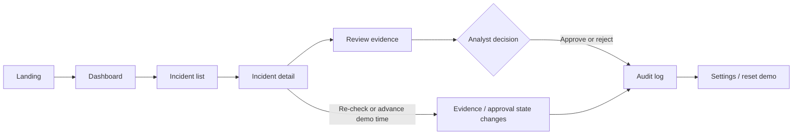

<div align="center">

# PHISHPILOT

### Phishing triage that questions trusted senders.

An interactive, fixture-backed incident response demo. Follow an email from first review through analyst decision, simulated evidence changes, and the audit trail — all in one application.

[](https://react.dev/)
[](https://www.typescriptlang.org/)
[](https://tanstack.com/start)
[](https://vite.dev/)
[](https://vitest.dev/)

</div>

> **Demo, not a live security service.** The app runs on local fixtures and deterministic demo behavior. It does not scan URLs, inspect real mailboxes, call an AI model, or execute response actions. Approval records a decision only.

## At a glance

| | |
|---|---|
| **Sign-in** | None — opens directly into the demo |
| **Data** | Synthetic fixtures, kept in React context in memory |
| **Clock** | Simulated and controlled from the app |
| **External actions** | None — decisions are recorded locally |
| **Reset** | Restore the starting demo state from **Demo controls** or **Settings** |

## The workflow



### Routes

| Route | What to do there |
|---|---|
| `/` | Explore the product overview and open the dashboard or a scenario |
| `/dashboard` | Review fixture-backed incident counts, risk distribution, and recent activity |
| `/incidents` | Search and filter the sample incident queue |
| `/alerts` | Review and filter priority alerts derived from simulated incident and approval states |
| `/incidents/DEMO-TRUSTED-01` | Inspect the trusted-sender case, compare behavior, and review its signals |
| `/incidents/DEMO-LINK-DRIFT-01` | Advance simulated time or re-check the local link observation |
| `/incidents/DEMO-DISSENT-01` | Review distinct analyzer verdicts and try the justification requirement |
| `/incidents/DEMO-CREDENTIAL-02` | Review a simulated unfamiliar sign-in domain and stale approval |
| `/incidents/DEMO-STATEMENT-03` | Review a low-risk notice with a valid sample approval |
| `/incidents/DEMO-ATTACHMENT-04` | Inspect an unexpected attachment scenario with critical sample risk |
| `/incidents/DEMO-IMPERSONATION-05` | Review a lookalike sender awaiting a human decision |
| `/incidents/DEMO-PAYROLL-06` | Inspect a rejected payment-deviation scenario |
| `/hurdle/trusted-sender` | Read the standalone trusted-sender case study |
| `/audit` | Search and filter incident-linked demo events |
| `/settings` | View read-only demo configuration and reset the fixtures |

## Sample incident data

All addresses and domains below use the reserved `.example` namespace. They are fabricated examples, not reports about real organizations.

| Incident | Subject | Risk | Initial status | Approval state | Scenario |
|---|---|---:|---|---|---|
| `DEMO-TRUSTED-01` | Updated remittance details | High · 85 | Escalated | Stale | Authenticated partner introduces a new link and bank-detail change |
| `DEMO-LINK-DRIFT-01` | Review the shared document | High · 82 | Needs re-review | Valid | Local link observation changes after approval |
| `DEMO-DISSENT-01` | Review the shared document | High · 74 | Escalated | Superseded | URL and sender-behavior verdicts disagree |
| `DEMO-CREDENTIAL-02` | Review your shared workspace access | Medium · 56 | In review | Stale | Unfamiliar sign-in domain |
| `DEMO-STATEMENT-03` | Your monthly statement is ready | Low · 12 | Approved | Valid | Expected-pattern low-risk notice |
| `DEMO-ATTACHMENT-04` | Revised purchase order attached | Critical · 94 | New | Stale | Unexpected macro-enabled document (synthetic; no real file) |
| `DEMO-IMPERSONATION-05` | Action required: confirm payroll account | High · 78 | Awaiting approval | Valid | Lookalike sender requests account confirmation |
| `DEMO-PAYROLL-06` | Urgent: release the revised payroll file | Medium · 48 | Rejected | Superseded | New payment destination and unusual urgency |

Each sample has an approval record, incident evidence, sender context where available, and analyzer verdicts. The alert queue is derived from each sample's current risk, incident status, and approval state. The audit page includes seeded history for the scenarios; interactions during a session append new events. The fixture source of truth is [`src/data/demo/`](./src/data/demo/), loaded through [`src/lib/store.tsx`](./src/lib/store.tsx).

## Try the complete demo

### 1. Start locally

Requirements: Node.js compatible with the installed Vite 8 toolchain and npm.

```sh
npm install
npm run dev
```

Open the local address printed by Vite (usually `http://localhost:5173`). If that port is in use, Vite prints the alternate one it selected. No `.env` file, account, database, or backend is needed for the demo workflow.

### 2. Explore the dashboard and incidents

1. Open **Dashboard** and review the sample counts, risk distribution, and activity.
2. Select **Incidents** to search and filter the eight sample records by status or approval state.
3. Use **Alert desk** on the dashboard or select **Alerts** in the sidebar to review priority-ranked cases.
4. Follow **Incident tracker** on the dashboard to see each case's current stage from intake through decision.
5. Open an incident to inspect its evidence, current approval, and timeline.

### 3. Exercise the decision flow

1. Open **Analysts disagree** from the sidebar’s **Scenarios** section or the incident list.
2. Compare the four separate analyzer verdicts. The disagreement alert explains why human review is required.
3. Enter at least 15 characters in **Analyst justification**, then select **Approve** or **Reject**.
4. Open **Audit** to see the decision and justification events linked back to the incident.

### 4. Simulate evidence drift

1. Reset the demo from **Settings** (or **Demo controls**) for a predictable starting point.
2. Open **Link drifts after approval** from **Demo controls**.
3. Choose **Advance +2h**. The local fixture reaches its changed observation 95 simulated minutes after the starting clock; the approval becomes invalidated and the incident returns to **Needs re-review**.
4. Check the incident timeline and **Audit** for the re-check, invalidation, and re-review events.
5. Select **Reset demo** to restore the initial fixtures and simulated clock.

> The link transition is simulated local intelligence. It does not make a network request or perform live scanning.

## Interface notes

- One shared navigation shell and demo-data indicator across the application.
- Demo controls expose the simulated clock, `+30m`, `+1h`, `+2h`, scenario shortcuts, and reset.
- Incident, approval, decision, and audit updates stay in memory and reset on page reload.
- Reduced-motion preferences are respected for route and section transitions.
- A decision is illustrative only: no message is sent, quarantined, deleted, or otherwise acted upon.

## Tech stack

- React 19, TypeScript, TanStack Start and TanStack Router
- Vite 8, Tailwind CSS 4, Radix UI primitives, and lucide-react
- Recharts for dashboard visualizations
- Vitest and Testing Library for UI and workflow tests
- A separate `backend/` prototype exists, but it is not required or connected to this local demo flow.

## Checks

```sh
npm test
npm run lint
npx tsc --noEmit
npm run build
```

## Project layout

```text
src/
├── components/       Shared shell, workflow, and UI components
├── data/demo/        Synthetic fixture records
├── lib/store.tsx     In-memory React store and simulated-clock behavior
├── routes/           Landing, dashboard, incidents, hurdle, audit, and settings
└── test/             Workflow and routing tests
backend/              Separate optional API prototype; not used by the demo UI
```
